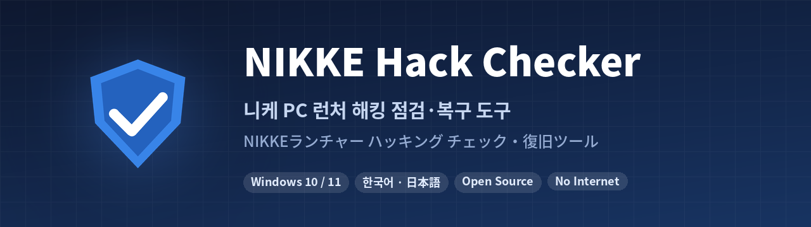

<p align="center">
  
</p>

<p align="center">
  <a href="README.md">한국어</a> · <b>日本語</b>
</p>

<p align="center">
  <a href="../../releases/latest"></a>
</p>

<p align="center">
  
  
  
</p>

2026年11月の **NIKKE(勝利の女神:NIKKE)PCランチャー改ざん事件** で、自分のPCが感染していないかを確認し、残った痕跡を整理するWindows用プログラムです。

- **チェックは読み取りのみ**です。何も変更しません。
- **対処は自分でチェックした項目だけ**を実行し、削除前にレポートを先に保存します。
- **インターネットに接続しません。** 結果がどこかへ送信されることはありません。
- **NIKKEをすでに削除した人**も、削除後に残る痕跡をチェックできます。

> [!WARNING]
> 非公式のコミュニティ製ツールです。Level Infinite・SHIFT UPとは関係ありません。
> 「痕跡なし」と出ても**安全の保証ではありません。** 9/27以降にPCランチャーを起動したことがあるなら、[感染していた場合の対処](#-感染していた場合の対処)に従ってください。

---

## 📥 ダウンロード

[**Releases**](../../releases/latest) からダウンロードしてください。

| ファイル | 説明 |
|---|---|
| `nikke_check_ja.exe` | 日本語版 |
| `nikke_check_ko.exe` | 韓国語版 |
| `SHA256SUMS.txt` | ファイルが改ざんされていないか確認するハッシュ値 |

Releasesのexeは**このリポジトリのソースからそのままビルド**したもので、自分でビルドしても同じファイル(同じハッシュ)になります。[このexeは信用できますか?](#-このexeは信用できますか) を参照してください。

> [!NOTE]
> 署名されていないプログラムのため、**「WindowsによってPCが保護されました」** と表示されることがあります。**[詳細情報] → [実行]** を押してください。
> Defenderにブロックされる場合は[よくある質問](#-よくある質問)をご覧ください。

## 🚀 使い方

### NIKKEがインストールされている場合

1. プログラムを起動します。(起動時には何も自動で行いません)
2. **[自動で探す]** または **[フォルダーを選んで追加...]** でNIKKEのインストールフォルダーを追加します。
   - エクスプローラーからNIKKEのフォルダーやランチャーのショートカットをウィンドウにドラッグ&ドロップしても追加できます。
   - Google Play Games版・公式ランチャー版・Steam版が別々にある場合は、すべて追加してください。
3. **[② チェック開始]** を押します。
4. 結果を確認して **[③ チェックした項目を対処]** を押します。

### NIKKEをすでに削除した場合

**[NIKKEはもう削除しました → すぐにチェック・対処]** ボタンを押してください。インストールフォルダーなしで、削除後も残る痕跡をチェックします。

### 結果の見方

| 表示 | 意味 |
|---|---|
| 🔴 **感染の痕跡** | エージェントが実行されたか、常駐の仕組みが残っている |
| 🟠 **注意** | 攻撃者のコードを読み込んだ痕跡。感染の可能性ありとして対応 |
| 🔵 **予防措置** | 感染ではないが、やっておくとよいこと(キャッシュ削除・サーバー遮断) |
| 🟣 **任意** | Cookie・データ削除。**初期状態ではチェックされません** |
| ⚪ **正常** | 問題なし |

チェックが終わると、下の詳細欄に **「こう判定した理由」** がすぐに表示されます。

## 🔍 チェックする項目

| チェック | 場所 |
|---|---|
| ランチャーのログにあるエージェントの実行記録 | `Launcher\intl_service\debug.log` |
| エージェントのダウンロード記録・残ったペイロード | `Launcher\log\tinyget\` |
| ランチャーの保存領域にあるエージェントの状態データ(`k2f.agent`) | `%APPDATA%\nikke_launcher\` |
| 攻撃者サーバーへの接続記録(HSTSハッシュを含む) | ランチャーの `TransportSecurity` など |
| ブラウザーの悪意のあるDLL(64文字のフォルダー) | `User Data\PlatformExperienceHelper\<64文字>\` |
| 旧バージョンの常駐ファイル | `Chrome\Application\PlatformExperienceHelper\` |
| レジストリのCOMハイジャック | `HKCU\Software\Classes\CLSID\{E77CC89B-…}` |
| 実行中のランチャー、悪意のあるDLLを読み込んだプロセス | メモリ |
| パスワードのダンプ・画面キャプチャの一時ファイル | `%TEMP%\k2f-bcreds-*`、`k2f_screen_*` |
| 攻撃者サーバーの遮断状態 | hosts、Windowsファイアウォール |
| (任意)ドライブ全体の精密チェック | すべての固定ドライブ |

Chrome・Edge・Whale・Brave・Vivaldi・Operaなど **Chromium系21種** とFirefoxを確認します。

<details>
<summary><b>正常なファイルには触りません</b></summary>

- `PlatformExperienceHelper` フォルダー自体、`LoadFeatures`、`platform_experience_helper.exe` は **Chromeの正常なファイル** です。
- `HKEY_LOCAL_MACHINE` 側の同じCLSID(`wpc.dll`)は **Windowsの正常な項目** です。
- hostsで遮断したアドレスがDNSキャッシュに表示されるのは、名前解決の記録ではありません。

</details>

## 🛠 対処機能

| 対処 | 内容 |
|---|---|
| レジストリキーの削除 | 削除前に `.reg` でバックアップ |
| 悪意のあるDLLフォルダー・ファイルの削除 | ブラウザーを閉じるか先に確認。ロックされていれば再起動後に自動で続きを整理 |
| ランチャーのキャッシュ(`tbs_cache`)の削除 | 改ざんされたファイルが再び実行されないように |
| ランチャー・感染したプロセスの終了 | `explorer.exe` は終了しません |
| 攻撃者サーバーの遮断 | hostsで3ドメイン + ファイアウォールで2IP(管理者権限) |

**安全のための仕組み**
- 削除前にレポートを先に保存し、**保存に失敗したら何も削除しません。**
- 削除の直前にパスをもう一度検証し、既知の悪意のある場所でなければ削除しません。
- パスの途中にジャンクション・シンボリックリンクがあれば削除しません。
- 名前だけが同じで中身がエージェントではないファイルは、報告だけします。

### 🟣 任意: Cookie・データの削除

NIKKEのフォルダーなしでチェックした場合や、感染の痕跡が見つかった場合に表示されます。**初期状態ではオフ**で、自分でチェックしたときだけ実行されます。

- **NIKKEランチャーのデータすべて**: 保存されたログイン・キャッシュ・エージェントの状態
- **ブラウザーごとのCookie**: すべてのサイトからログアウトされ、盗まれたCookieが使えなくなります
- **ブラウザーごとのサイトデータ**: Local Storage、IndexedDBなど

パスワード・ブックマーク・閲覧履歴・拡張機能は削除しません。ウォレット拡張機能の保存領域も除外します。

### 🧹 PCかんたん最適化

下にある **[PCかんたん最適化]** ボタンを押してください。

| 項目 | 初期状態 |
|---|---|
| 一時ファイルの整理(1日以上経ったもの) | ✅ |
| ブラウザーキャッシュの整理(ログインはそのまま) | ✅ |
| DNSキャッシュのクリア | ✅ |
| ごみ箱を空にする | ⬜(元に戻せないため) |
| スタートアッププログラム一覧・ドライブの空き容量 | 表示のみ |

## 🚨 感染していた場合の対処

> [!IMPORTANT]
> パスワードの変更は **別のきれいな端末(スマートフォンなど)で** 行ってください。

1. 公式発表があるまで **PC版NIKKEのランチャーを起動しないでください。**
2. NIKKE / Level Infinite → メール・Discord・銀行・ブラウザーに保存した **すべてのパスワードを変更**し、2段階認証をオンに
3. Google・Discord・Steam・X・GitHubなどで **「すべての端末からログアウト」**(盗まれたCookieを無効化)
4. APIトークン、SSHキー、開発用・クラウドCLIの認証情報を **無効化して再発行**
5. 暗号資産のウォレットは **新しいシードで作った新しいウォレット** へ移動
6. ほかのWindowsユーザーアカウントがあれば、そのアカウントでももう一度実行
7. 最も確実なのは **バックアップしてWindowsを再インストール** することです。

## ❓ よくある質問

<details>
<summary><b>Defender(ウイルス対策ソフト)にブロックされます</b></summary>

このプログラムはブラウザーフォルダーの確認、レジストリの削除、hostsの変更など、見た目がマルウェアに似た処理を行うため、誤検知されることがあります。

- ソースは公開されており、Releasesのexeはこのソースからビルドしたものです。
- 誤検知の場合は [Microsoftに報告](https://www.microsoft.com/en-us/wdsi/filesubmission) してください。(Incorrect detection を選択)
- 心配な場合は [自分でビルド](#-自分でビルド) してお使いください。

</details>

<details>
<summary><b>対処後にもう一度チェックすると「DNSキャッシュ analytics.insightjs.com」の感染が出ます</b></summary>

v2.5.3以前の誤検知です。hostsで遮断するとWindowsがそのアドレスをDNSキャッシュ一覧にも載せるため、それを接続記録と誤って判定していました。**v2.5.4で修正済み**です。

</details>

<details>
<summary><b>「痕跡なし」なら安全ですか?</b></summary>

既知の痕跡がないという意味で、安全の保証ではありません。NIKKEを削除・再インストールすると最も確実な証拠であるランチャーのログが消えますし、攻撃者が新しい手口を使っていればこのツールでは見つけられません。

</details>

<details>
<summary><b>インストール先が特殊で見つかりません</b></summary>

**[フォルダーを選んで追加...]** で直接追加するか、エクスプローラーからフォルダーをドラッグ&ドロップしてください。`D:\Games` のような上位フォルダーや `Launcher` フォルダーを指定しても自動で探します。**[ドライブ全体の精密チェック]** をオンにすると、ドライブ全体から探します。

</details>

<details>
<summary><b>DMM版も対象ですか?</b></summary>

公開されている解析資料では、対象はLevel InfiniteのPCランチャーです。DMM版については言及がないため、このツールでは特別な対応をしていません。

</details>

## 🔐 このexeは信用できますか?

1. **ハッシュの確認**: PowerShellで、次の値が `SHA256SUMS.txt` と同じか確認します。
   ```powershell
   Get-FileHash .\nikke_check_ja.exe -Algorithm SHA256
   ```
2. **自分でビルドして比較**: 下の方法でビルドすると、同じGoのバージョン(1.24.7)ならReleasesと**同じハッシュのexe**ができます。他人が作ったexeが心配な場合は、自分でビルドしたものを使ってください。

## 🧱 自分でビルド

[Go](https://go.dev/dl/) 1.24以上があれば十分です。外部パッケージは使っていません。

```powershell
# Windows (PowerShell)
.\build.ps1
```

```bash
# Linux・Mac・WSL
./build.sh
```

`nikke_check_ko.exe`、`nikke_check_ja.exe` が作成されます。

画面の文言を変更した場合は、`python3 res/gen_i18n.py` で翻訳を作り直してください。訳漏れがあると停止して知らせます。

## 📚 参考資料

チェックの基準は、以下の公開資料を参考にしました。コードはこのプロジェクトで新しく書いたものです。

- [MotherSphere — NIKKE PC launcher compromise の解析](https://gist.github.com/MotherSphere/d6c049a09ba8ac3085c51ee9df24a4e5)
- [nikke-checker](https://github.com/nikke-checker/nikke-checker) — HSTSハッシュキー、エージェントのビルドETag、旧バージョンの常駐ファイル、削除時の安全ルール
- 韓国のNIKKEコミュニティ(DCインサイド NIKKEマイナーギャラリー)のまとめ

## 📄 ライセンス

[MIT](LICENSE)。このプログラムは現状のまま提供され、使用によって生じた問題について責任を負いません。
NIKKEはSHIFT UP・Level Infiniteの商標であり、このプロジェクトは両社とは関係ありません。
