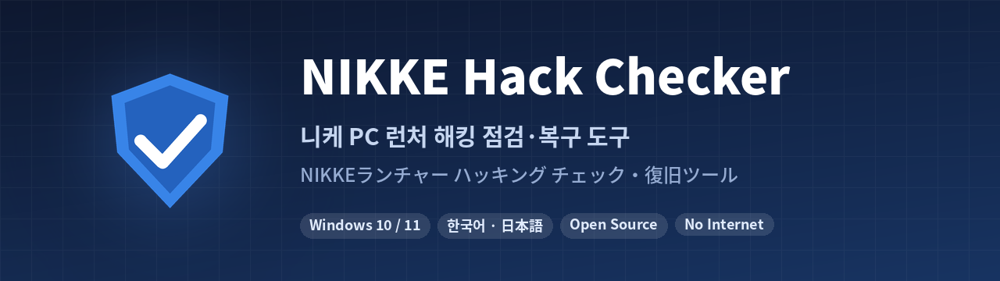

<p align="center">
  
</p>

<p align="center">
  <b>한국어</b> · <a href="README.ja.md">日本語</a>
</p>

<p align="center">
  <a href="../../releases/latest"></a>
</p>

<p align="center">
  <a href="../../actions/workflows/build.yml"></a>
  
  
  
</p>

2026년 11월 **NIKKE(승리의 여신: 니케) PC 런처 해킹 사태**로 내 PC가 털렸는지 확인하고, 남은 흔적을 정리하는 윈도우 프로그램입니다.

- **검사는 읽기 전용**입니다. 아무것도 바꾸지 않습니다.
- **해결은 직접 체크한 항목만** 실행하고, 지우기 전에 보고서를 먼저 저장합니다.
- **인터넷에 접속하지 않습니다.** 결과가 어디로도 전송되지 않습니다.
- **니케를 이미 지운 사람**도 지운 뒤에도 남는 흔적을 점검할 수 있습니다.

> [!WARNING]
> 비공식 커뮤니티 도구입니다. Level Infinite·SHIFT UP과 관계없습니다.
> "흔적 없음"이 나와도 **안전하다는 보증은 아닙니다.** 9/27 이후 PC 런처를 켠 적이 있다면 [털렸을 때 할 일](#-털렸을-때-할-일)을 따르세요.

---

## 📥 다운로드

[**Releases**](../../releases/latest)에서 받으세요.

| 파일 | 설명 |
|---|---|
| `nikke_check_ko.exe` | 한국어판 |
| `nikke_check_ja.exe` | 일본어판 |
| `SHA256SUMS.txt` | 파일이 바뀌지 않았는지 확인하는 해시값 |

Releases의 exe는 **사람이 올린 게 아니라 GitHub Actions가 이 저장소의 소스로 직접 빌드**한 것입니다. [이 exe를 믿어도 되나요?](#-이-exe를-믿어도-되나요) 참고.

> [!NOTE]
> 서명되지 않은 프로그램이라 **"Windows의 PC 보호"** 창이 뜰 수 있습니다. **[추가 정보] → [실행]**을 누르면 됩니다.
> Defender가 막으면 [자주 묻는 질문](#-자주-묻는-질문)을 보세요.

## 🚀 사용법

### 니케가 설치되어 있으면

1. 프로그램을 실행합니다. (켤 때는 아무것도 자동으로 하지 않습니다)
2. **[자동으로 찾기]** 또는 **[폴더 선택해서 추가]**로 니케 설치 폴더를 넣습니다.
   - 탐색기에서 니케 폴더나 런처 바로가기를 창에 끌어다 놓아도 됩니다.
   - 구글 플레이 게임즈·공식 런처·스팀판이 따로 있으면 전부 넣으세요.
3. **[② 검사 시작]**을 누릅니다.
4. 결과를 확인하고 **[③ 체크한 항목 해결]**을 누릅니다.

### 니케를 이미 지웠으면

**[이미 니케를 지웠어요 → 바로 점검·조치]** 버튼을 누르세요. 설치 폴더 없이, 지운 뒤에도 남는 흔적을 점검합니다.

### 결과 읽는 법

| 표시 | 뜻 |
|---|---|
| 🔴 **감염 흔적** | 에이전트가 실행됐거나 지속성 장치가 남아 있음 |
| 🟠 **주의** | 공격자 코드를 불러온 흔적. 감염 가능성으로 대응 |
| 🔵 **예방 조치** | 감염은 아니지만 해 두면 좋은 것 (캐시 삭제·서버 차단) |
| 🟣 **선택 사항** | 쿠키·데이터 삭제. **기본으로 체크되지 않음** |
| ⚪ **정상** | 문제 없음 |

검사가 끝나면 아래 상세창에 **"이렇게 판단한 이유"**가 바로 나옵니다.

## 🔍 무엇을 검사하나

| 검사 | 위치 |
|---|---|
| 런처 로그의 에이전트 실행 기록 | `Launcher\intl_service\debug.log` |
| 에이전트 다운로드 기록·남은 페이로드 | `Launcher\log\tinyget\` |
| 런처 저장소의 에이전트 상태값 (`k2f.agent`) | `%APPDATA%\nikke_launcher\` |
| 공격자 서버 접속 기록 (HSTS 해시 포함) | 런처 `TransportSecurity` 등 |
| 브라우저 악성 DLL (64자리 폴더) | `User Data\PlatformExperienceHelper\<64자리>\` |
| 구버전 지속성 파일 | `Chrome\Application\PlatformExperienceHelper\` |
| 레지스트리 COM 하이재킹 | `HKCU\Software\Classes\CLSID\{E77CC89B-…}` |
| 실행 중인 런처, 악성 DLL이 로드된 프로세스 | 메모리 |
| 비밀번호 덤프·화면 캡처 임시 파일 | `%TEMP%\k2f-bcreds-*`, `k2f_screen_*` |
| 공격자 서버 차단 상태 | hosts, 윈도우 방화벽 |
| (선택) 전체 드라이브 정밀 검사 | 모든 고정 드라이브 |

크롬, 엣지, 웨일, 브레이브, 비발디, 오페라 등 **크로미움 계열 21종**과 파이어폭스를 확인합니다.

<details>
<summary><b>정상 파일은 건드리지 않습니다</b></summary>

- `PlatformExperienceHelper` 폴더 자체, `LoadFeatures`, `platform_experience_helper.exe`는 **크롬 정상 파일**입니다.
- `HKEY_LOCAL_MACHINE` 쪽의 같은 CLSID(`wpc.dll`)는 **윈도우 정상 항목**입니다.
- hosts로 막아 둔 주소가 DNS 캐시에 보이는 것은 조회 기록이 아닙니다.

</details>

## 🛠 해결 기능

| 해결 | 내용 |
|---|---|
| 레지스트리 키 삭제 | 삭제 전에 `.reg` 백업 |
| 악성 DLL 폴더·파일 삭제 | 브라우저를 닫을지 먼저 물어봄. 잠겨 있으면 재부팅 후 자동으로 이어서 정리 |
| 런처 캐시(`tbs_cache`) 삭제 | 변조된 파일이 다시 실행되지 않게 |
| 런처·감염 프로세스 종료 | `explorer.exe`는 종료하지 않음 |
| 공격자 서버 차단 | hosts 3개 도메인 + 방화벽 2개 IP (관리자 권한) |

**안전장치**
- 지우기 전에 보고서를 먼저 저장하고, **저장에 실패하면 아무것도 지우지 않습니다.**
- 삭제 직전에 경로를 다시 검증합니다. 알려진 악성 위치가 아니면 지우지 않습니다.
- 경로 중간에 정션·심볼릭 링크가 있으면 지우지 않습니다.
- 이름만 같고 내용이 에이전트가 아닌 파일은 보고만 합니다.

### 🟣 선택 사항: 쿠키·데이터 삭제

니케 폴더 없이 검사했거나 감염 흔적이 나오면 표시됩니다. **기본으로 꺼져 있고**, 직접 체크해야만 실행됩니다.

- **니케 런처 데이터 전체**: 저장된 로그인·캐시·에이전트 상태
- **브라우저별 쿠키**: 모든 사이트에서 로그아웃되어 훔쳐 간 쿠키가 쓸모없어짐
- **브라우저별 사이트 데이터**: Local Storage, IndexedDB 등

비밀번호·북마크·방문 기록·확장 프로그램은 지우지 않습니다. 지갑 확장 프로그램 저장소도 제외합니다.

### 🧹 PC 간단 최적화

하단의 **[PC 간단 최적화]** 버튼을 누르면 됩니다.

| 항목 | 기본 |
|---|---|
| 임시 파일 정리 (하루 이상 지난 것) | ✅ |
| 브라우저 캐시 정리 (로그인 유지) | ✅ |
| DNS 캐시 비우기 | ✅ |
| 휴지통 비우기 | ⬜ (되돌릴 수 없어서) |
| 시작 프로그램 목록·드라이브 여유 공간 | 보기만 |

## 🚨 털렸을 때 할 일

> [!IMPORTANT]
> 비밀번호 변경은 **다른 깨끗한 기기(스마트폰 등)로** 하세요.

1. 공식 발표 전까지 **PC 니케 런처를 켜지 마세요.**
2. 니케/레벨인피니트 → 이메일·디스코드·은행·브라우저에 저장된 **모든 비밀번호 변경**, 2단계 인증 켜기
3. 구글·디스코드·스팀·깃허브 등에서 **"모든 기기에서 로그아웃"** (훔친 쿠키 무효화)
4. API 토큰, SSH 키, 개발용·클라우드 CLI 자격 증명 **폐기 후 재발급**
5. 암호화폐 지갑은 **새 시드로 만든 새 지갑**으로 이동
6. 다른 윈도우 사용자 계정이 있으면 그 계정으로도 한 번 더 실행
7. 가장 확실한 방법은 **백업 후 윈도우 재설치**입니다.

## ❓ 자주 묻는 질문

<details>
<summary><b>Defender(백신)가 이 프로그램을 막아요</b></summary>

이 프로그램은 브라우저 폴더 확인, 레지스트리 삭제, hosts 수정처럼 악성코드와 겉보기에 비슷한 일을 해서 오탐이 날 수 있습니다.

- 소스가 공개되어 있고, Releases의 exe는 GitHub Actions가 직접 빌드합니다.
- 오탐이면 [Microsoft에 신고](https://www.microsoft.com/en-us/wdsi/filesubmission)해 주세요. (Incorrect detection 선택)
- 걱정되면 [직접 빌드](#-직접-빌드)해서 쓰세요.

</details>

<details>
<summary><b>해결 후 다시 검사하니 "DNS 캐시 analytics.insightjs.com" 감염이 떠요</b></summary>

v2.5.3 이하의 오탐입니다. hosts로 차단하면 윈도우가 그 주소를 DNS 캐시 목록에도 올리는데, 이걸 접속 기록으로 잘못 읽었습니다. **v2.5.4에서 수정**되었습니다.

</details>

<details>
<summary><b>"흔적 없음"이면 안전한 건가요?</b></summary>

알려진 흔적이 없다는 뜻이지, 안전 보증은 아닙니다. 니케를 지우거나 재설치하면 가장 확실한 증거인 런처 로그가 사라지고, 공격자가 새로운 방법을 썼다면 이 도구로 찾을 수 없습니다.

</details>

<details>
<summary><b>설치 경로가 특이한데 못 찾아요</b></summary>

**[폴더 선택해서 추가]**로 직접 넣거나, 탐색기에서 폴더를 끌어다 놓으세요. `D:\Games`처럼 상위 폴더나 `Launcher` 폴더를 넣어도 알아서 찾아갑니다. **[전체 드라이브 정밀 검사]**를 켜면 드라이브 전체에서 찾습니다.

</details>

## 🔐 이 exe를 믿어도 되나요?

1. **해시 확인**: PowerShell에서 아래 값이 `SHA256SUMS.txt`와 같은지 봅니다.
   ```powershell
   Get-FileHash .\nikke_check_ko.exe -Algorithm SHA256
   ```
2. **빌드 출처 확인**: Releases의 exe는 GitHub가 이 저장소에서 빌드했다는 증명(attestation)이 붙어 있습니다.
   ```powershell
   gh attestation verify .\nikke_check_ko.exe --repo <소유자>/<저장소>
   ```
3. **직접 빌드**: 아래 방법으로 빌드하면 같은 Go 버전에서 같은 exe가 나옵니다.

## 🧱 직접 빌드

[Go](https://go.dev/dl/) 1.24 이상만 있으면 됩니다. 외부 패키지는 쓰지 않습니다.

```powershell
# 윈도우 (PowerShell)
.\build.ps1
```

```bash
# 리눅스·맥·WSL
./build.sh
```

`nikke_check_ko.exe`, `nikke_check_ja.exe`가 만들어집니다.

<details>
<summary>파일 구성</summary>

| 파일 | 내용 |
|---|---|
| `main.go` | 창(UI) |
| `scan.go` | 감염 흔적 검사 (읽기 전용) |
| `fix.go` | 해결 (체크한 항목만, 경로 재검증 후) |
| `wipe.go` | 쿠키·사이트 데이터·런처 데이터 삭제 (선택) |
| `optimize.go` | PC 간단 최적화 |
| `procs.go` | 프로세스·모듈 목록, 정션 확인 |
| `win.go` | Win32 API |
| `i18n.go` | 일본어 번역 (`res/gen_i18n.py`로 생성) |
| `res/` | 아이콘·버전 정보·매니페스트, 번역 원본 |

화면 문구를 바꾸면 `python3 res/gen_i18n.py`로 번역을 다시 만듭니다. 번역이 빠진 문장이 있으면 멈추고 알려줍니다.

</details>

## 📚 참고 자료

점검 기준은 아래 공개 자료를 참고했습니다. 코드는 이 프로젝트에서 새로 작성했습니다.

- [MotherSphere — NIKKE PC launcher compromise 분석](https://gist.github.com/MotherSphere/d6c049a09ba8ac3085c51ee9df24a4e5)
- [nikke-checker](https://github.com/nikke-checker/nikke-checker) — HSTS 해시 키, 에이전트 빌드 ETag, 구버전 지속성 파일, 삭제 안전장치 규칙
- 니케 마이너 갤러리 "해킹사태 총정리"

## 📄 라이선스

[MIT](LICENSE). 이 프로그램은 있는 그대로 제공되며, 사용으로 생긴 문제에 대해 책임지지 않습니다.
NIKKE는 SHIFT UP·Level Infinite의 상표이며, 이 프로젝트는 그들과 관계없습니다.
